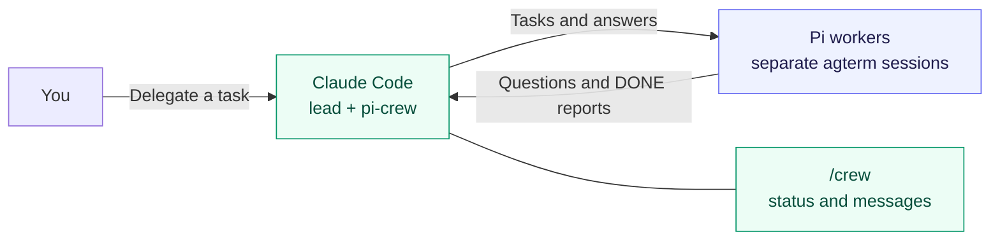

# pi-crew

**Delegate to Pi coding agents without leaving Claude Code.**

Running several agents in separate terminals means watching for blockers and copying results between sessions.
pi-crew gives Claude Code a crew of [Pi](https://github.com/badlogic/pi-mono) workers in [agterm](https://agterm.dev).
The lead assigns tasks, answers questions, and reviews completed work. You observe assignments and conversations in a read-only crew pane. Direct the agents through their terminals.



Questions, completed reports, and quiet-worker alerts start a lead turn.
Routine progress waits for your next prompt or the next turn about that worker.
Messages travel through the local [pi-intercom](https://github.com/nicobailon/pi-intercom) broker.

## Install

You need:

- Claude Code with **mod support**, running inside agterm with `agtermctl` on `PATH`.
- Pi with pi-intercom and its sibling `tsx` package installed. The default location is `~/.pi/agent/npm/node_modules/`.
- A Pi executable and an available model. The defaults, `pi-work` and `router/openai-work`, require your own setup.

To use the regular `pi` executable, set these **before starting Claude Code**:

```sh
export PI_CREW_PI_COMMAND=pi
export PI_CREW_DEFAULT_MODEL='<provider/model available in your Pi setup>'
```

Replace the model placeholder with your model id. For custom install paths, see [settings](docs/guide.md#settings).

```sh
claude plugin marketplace add alexei-led/pi-crew
claude plugin install pi-crew@pi-crew
```

Start a new Claude Code session in agterm, or run `/reload-plugins`.
Open `/crew` to check that the pane loads.

## Try it

Ask Claude Code:

> Create a worktree for a Pi worker named `api`. Have it add a health endpoint, run the relevant tests, commit its changes, and report back.

Each worker opens in a separate agterm session. Use `/crew` to explore its recent conversation. Ask the lead to answer questions or redirect work.

**Workers are not sandboxed.** Use one worktree per editing worker and review its diff before merging.
DONE checks compare reports with git state. They do not prove that tests ran or that the work is correct.

## Documentation

- [User guide](docs/guide.md) — messages, pane controls, tools, settings, and troubleshooting.
- [Architecture](docs/architecture.md) — module boundaries, delivery, stored data, and trust limits.
- [Contributing](CONTRIBUTING.md) — setup and verification.

For collaboration across developers and machines, see [crew-net](https://github.com/alexei-led/crew-net).
pi-crew manages workers on this machine.

## License

[MIT](LICENSE)
