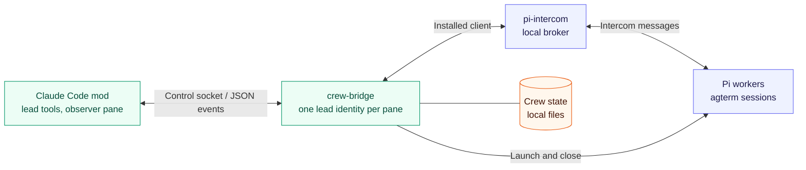
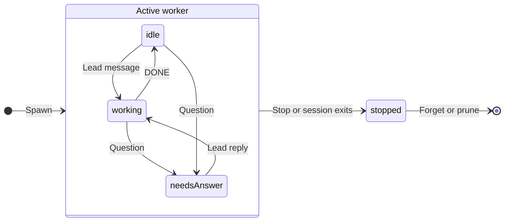
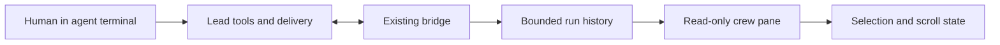

# Architecture

pi-crew is a Claude Code mod plus a local bridge process. The crew pane is a read-only observer.
The Pi transport uses the installed pi-intercom client rather than a separate messaging protocol.
Native Claude observation uses the host's mod API inside the mod, independently of the bridge. The diagram below shows the Pi transport path.

## Boundaries

| Module | Responsibility |
| --- | --- |
| [hooks/register.tsx](../hooks/register.tsx) | Registers tools, commands, lifecycle hooks, and progress delivery on user prompts. |
| [hooks/crew.ts](../hooks/crew.ts) | Plugin state, bridge supervision, prompt submission, manager acknowledgements, and read-only history navigation. |
| [hooks/claude.ts](../hooks/claude.ts) | Conversation-scoped native roster, lifecycle/message observation and explicit conversation snapshots; no manager delivery. |
| [hooks/claude-pane.tsx](../hooks/claude-pane.tsx) | Read-only native worker rows and threads in the shared pane. |
| [hooks/model.ts](../hooks/model.ts) | Pure layout, ordering, text framing, and shared UI vocabulary. |
| [hooks/band.tsx](../hooks/band.tsx), [hooks/pane.tsx](../hooks/pane.tsx) | Render the band and crew pane through the mod UI API. |
| [bridge/crew-bridge.mts](../bridge/crew-bridge.mts) | Process entry point, Unix control socket, broker connection, timers, and shutdown. |
| [bridge/crew.mts](../bridge/crew.mts) | Worker lifecycle, inbox, message feed, requests, and git-check orchestration. |
| [bridge/lib.mts](../bridge/lib.mts) | Parsing, state transitions, launch scripts, git checks, and file helpers. |
| [types/index.d.ts](../types/index.d.ts) | Shared request, event, worker, and plugin-state contracts. |

The bridge injects broker, terminal, git, clock, and event boundaries into `createCrew`.
The installed intercom client interface is mirrored for version 0.18.1. Changes to that internal API require integration testing.

## Worker lifecycle

Spawn starts in working state when given a task, otherwise idle.
Progress does not change task state. An unanswered question stays open even if a DONE follows it.
A respawn under the same name gets a new display number while retaining its deterministic intercom id.

## Delivery and recovery

1. The bridge persists an incoming report before sending its broker receipt.
2. It announces reports in order, after DONE verification, and only after the initial crew snapshot.
3. The mod holds progress. A question, DONE, quiet alert, or non-crew message starts a prompt submission.
4. After submission succeeds, the mod acknowledges the report and the bridge removes it from the inbox.

The agterm pane id determines the lead identity. Reload, clear, and resume in the same pane reuse it.
A restarted bridge replays unacknowledged reports and rechecks DONE claims.
The mod keeps recent seen ids to suppress duplicate delivery after reloads.

Dropped prompt submissions get up to 10 attempts, 15 seconds apart.
A report that still fails remains unacknowledged for replay.
The mod retries bridge exits with exponential backoff, up to 30 seconds between starts.
It stops after 20 consecutive attempts without a ready event.

Delivery is not exactly-once. A crash between prompt submission and acknowledgement can cause a replay.
The broker's offline mailbox is in memory. Restarting the broker loses messages not yet persisted by the bridge.

## Observer and manager separation

The lead still owns spawn/send/stop tools and delivery acknowledgements.
The pane queries history and can focus an agterm terminal. Browsing never calls send, stop, read-marker, or ack.

Worker records keep a per-spawn run id and an assignment separate from the last report.
Spawn records its first task. A new `send.task` explicitly replaces the assignment after delivery succeeds.
Ordinary replies leave it intact.

History requests use the same control socket: worker name, run id, optional exclusive message-id cursor, and a bounded page size.
They read the retained feed, not only the 200-message startup replay.
Expired cursors and changed runs fail instead of silently switching conversations.

New feed messages record whether the sender is the lead or worker.
Legacy outgoing records remain unattributed: their UI label is "To worker".
DONE feed records retain git-check results and check time. A result is evidence about that inspection, not ongoing checkout state.

The mod's local view keeps the selected run, expanded text, and a bounded history page.
Scrolling back or loading older records freezes that snapshot. Incoming reports only add observer-local newer ids until latest is selected.
A request counter rejects stale replies from overtaken navigation.

## Native Claude observation

Native records and view state use separate mod atoms. They never become bridge workers, Pi feed messages, held progress or delivery acknowledgements.
The pane combines the two sources only when rendering. Native observation requires no broker connection.

Successful spawns record identity, initial assignment and resolved model even before the asynchronous roster publishes the worker.
The host roster reconciles every five seconds; unchanged rosters do not rewrite observer state.
Agent IDs identify loops, teammate addresses identify team members, and display names resolve only when unique.
Confirmed replacement spawns increment a generation. Resumed turns preserve the generation and initial assignment.
Turn reports use turn IDs; identical message text is not deduplicated.

Successful `session.send` calls observe main-to-worker and worker-to-main communication.
The receive hook observes external teammate mailbox deliveries only when the harness marks them unverified.
This avoids duplicating in-process sends. It does not promise complete worker-to-worker traffic or recovery of unobserved sends.
The pane labels unverified sender claims and queued delivery without claiming a read receipt.

A conversation ID change hides old state immediately and resets it on reconciliation. Async reads reject stale owners, generations and navigation requests.
A conversation snapshot is an explicit agent-scoped API read; a denial never falls back to the main conversation.
Snapshot rows contain visible text and tool names only. No private transcript/inbox files are parsed and no native UI view is switched.
Reading or expanding content never sends messages, injects prompts, alters tasks, or acknowledges manager deliveries.

## Stored data

State lives under `PI_CREW_DIR/<pane>/`. See [settings](guide.md#settings) for its default.
Native observations live in mod state, scoped to the Claude conversation: at most 100 worker records, 50 messages per generation and 200 messages globally. Feed records expire after 24 hours; absent workers expire 30 minutes after their last observed activity. Assignment, message and snapshot text is bounded to 16,000 characters plus a truncation marker. Pinned view/snapshot content stays until navigation or conversation reset. These are recent observations, not an archive.

New crew directories use mode `0700`. JSON state, feed files, and briefs use `0600`. Launch scripts use `0700`.

| Data | Retention or bound |
| --- | --- |
| Worker records | Until forgotten. Stopped records are eligible for removal after 30 minutes. |
| Open questions | Until the lead sends a message or the worker stops. |
| Message feed | Latest 50 messages per worker run by default, no older than 24 hours, after pruning, configurable with `PI_CREW_HISTORY_LIMIT`. The global feed is capped at 1,000 lines and compacts to 750. Non-crew senders share one configured message budget. |
| Unacknowledged inbox | Until acknowledgement. Pending progress in the mod is capped at 50 reports. Overflow drops and acknowledges the oldest. |
| Pending intercom asks | Entries older than one day are discarded at load. The broker can expire them earlier. |
| Worker briefs and launchers | Remain in the crew directory, including after a worker is forgotten. |
| Other inactive crew directories | Removed at bridge startup after seven days without a change. |

Pruning runs at startup and every five minutes.
Malformed workers, inbox, or asks files are renamed to `<name>.bad-<timestamp>` and reported instead of silently overwritten.
The pane is a recent-message view, not a permanent archive. Delivered report text is also in the lead's transcript.

## Trust and limits

- Workers have the Pi process's filesystem, command, network, and credential access. A worktree is not a sandbox.
- The working-directory brief and git checks detect some mistakes. They do not confine workers or detect every edit outside a worktree.
- DONE verification checks current git state and reported fields. It does not execute tests, validate log contents, or attribute main-checkout changes to a worker.
- The Unix control socket uses mode `0600`. This is a same-user local workflow, not an authenticated multi-user service.
- Other broker sessions can message the lead and start turns. Quoting their text does not prevent prompt injection.
- Task briefs, messages, and quiet-alert terminal excerpts can contain private code or secrets. They can enter the lead's model context.
- Transport is local. Model API requests still follow each agent's provider configuration.
